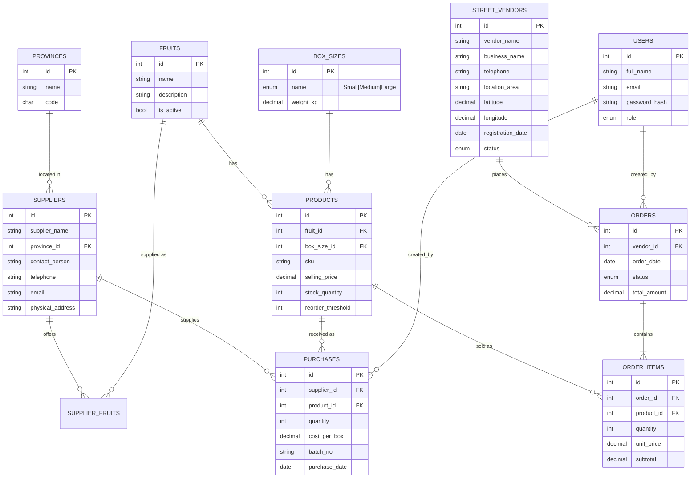

# Entity Relationship Diagram

The rendered diagram is in [`erd.svg`](erd.svg). The same model as a Mermaid diagram (renders on GitHub):

## Key design decisions

- **Fruit + Box Size = Product.** `products` has `UNIQUE(fruit_id, box_size_id)`, so Apples (Small), Apples (Medium) and Apples (Large) are three rows, each with its own `selling_price` and `stock_quantity`.
- **Supplier to Stock.** `purchases` links a supplier to a product. Recording a purchase increments `products.stock_quantity` in the same transaction.
- **Price snapshot.** `order_items.unit_price` copies the product price at order time, so later price changes do not rewrite history.
- **Integrity.** CHECK constraints (price > 0, quantity > 0, stock >= 0), UNIQUE keys, and foreign keys on every relationship.
